# DarkMaterial on Rust

**Recriação do [DankMaterialShell](https://github.com/AvengeMedia/DankMaterialShell) (DMS) para o compositor [driftwm](https://github.com/malbiruk/driftwm)**, renderizada com [EWW](https://github.com/elkowar/eww) e movida por um daemon em **Rust** (`dmr`), empacotada para **NixOS** (instalador de um comando, módulo sem flake e flake).

O DMS original é feito em QML/Quickshell com um backend em Go. O DarkMaterial reproduz o visual e as funções dele — DankBar, Spotlight, Central de Controle, DankDash, notificações, OSD, menu de energia, tela de bloqueio e o tema Material You gerado do wallpaper — sobre o driftwm, que é um compositor de canvas infinito, usando **~5× menos memória** e menos CPU.

A arquitetura é a mesma do meu projeto [Sheels](https://github.com/pabl0conepc-alt/Sheels) (recriação do Caelestia).

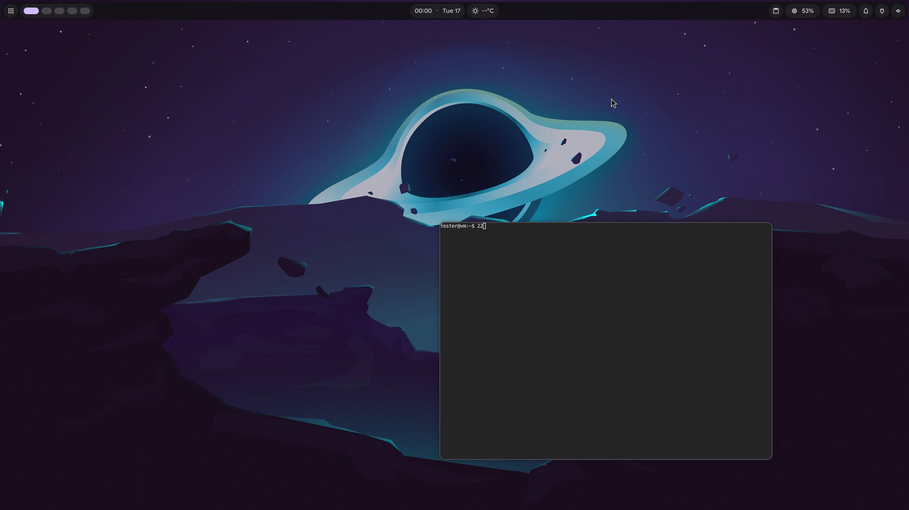

| Spotlight | Central de Controle |
|---|---|
| 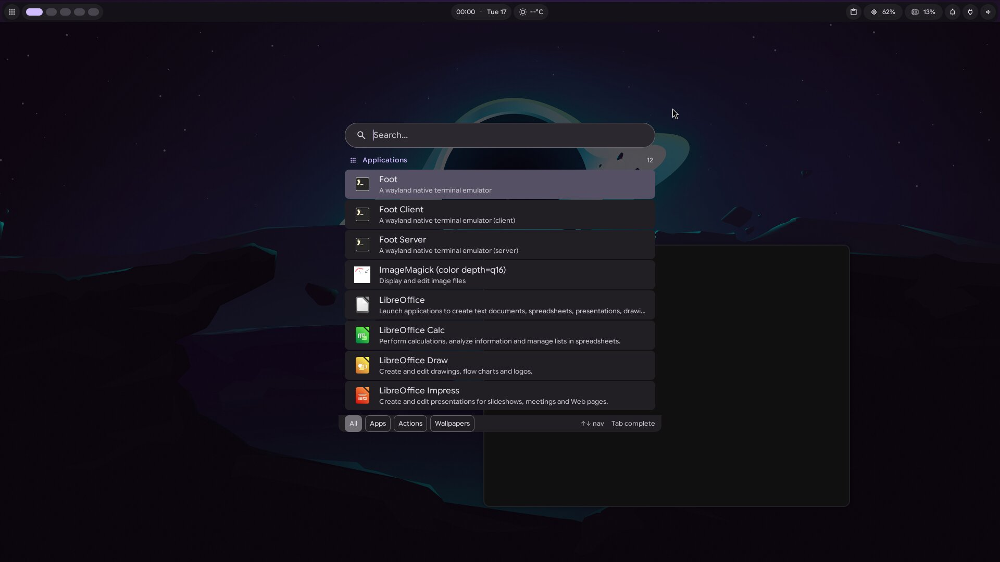 | 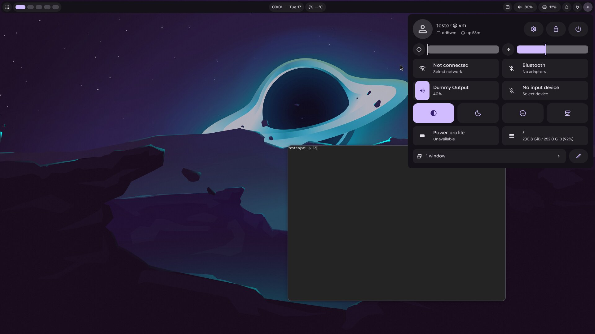 |
| **DankDash (Overview)** | **Central de notificações** |
| 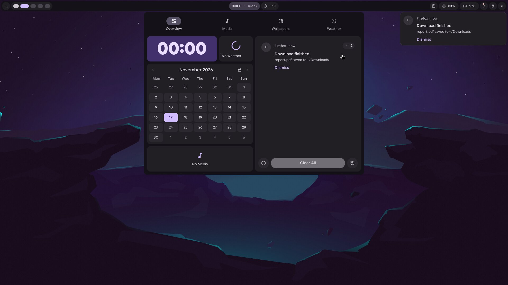 | 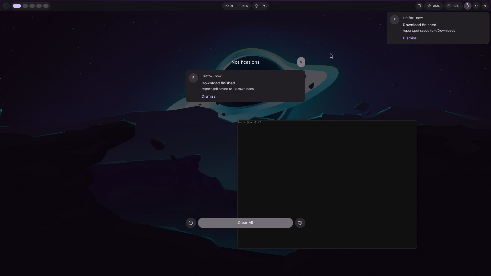 |
| **Menu de energia** | **OSD de volume** |
| 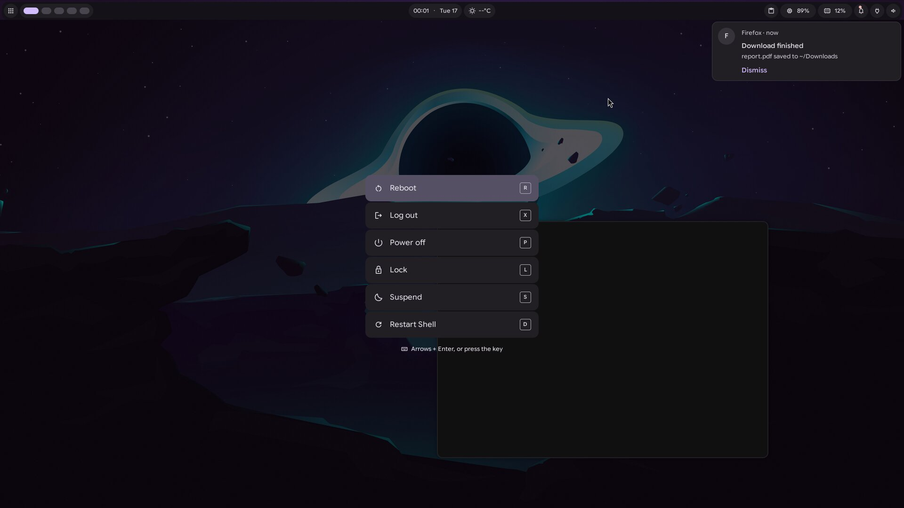 | 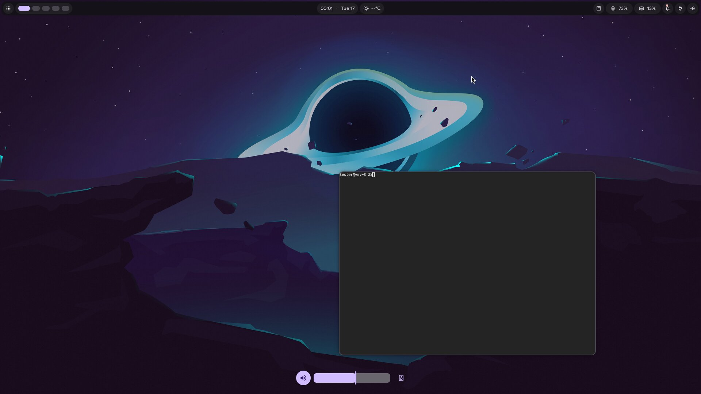 |
| **Dash → Wallpapers** | **Popup de notificação** |
| 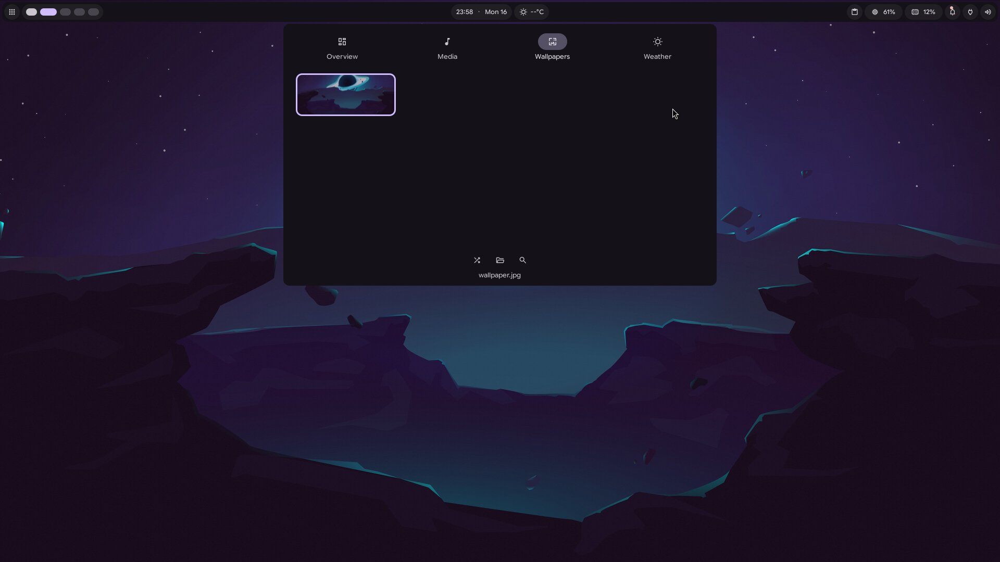 | 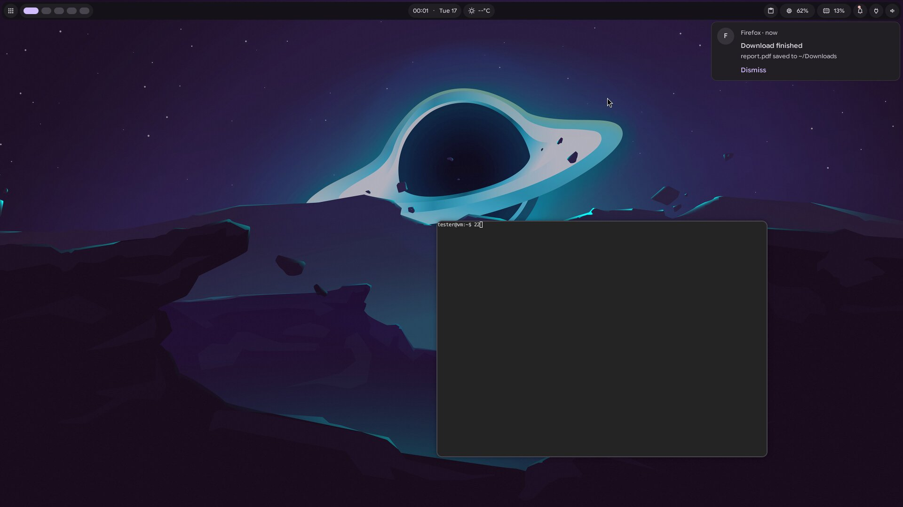 |
| **Material You do wallpaper (`dynamic`)** | **Dash → Mídia (MPRIS)** |
| 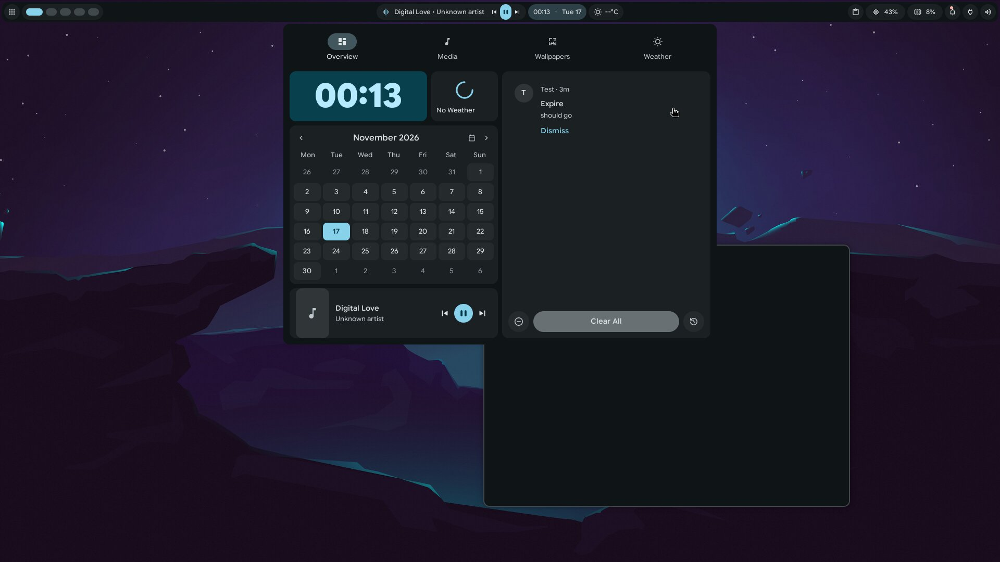 | 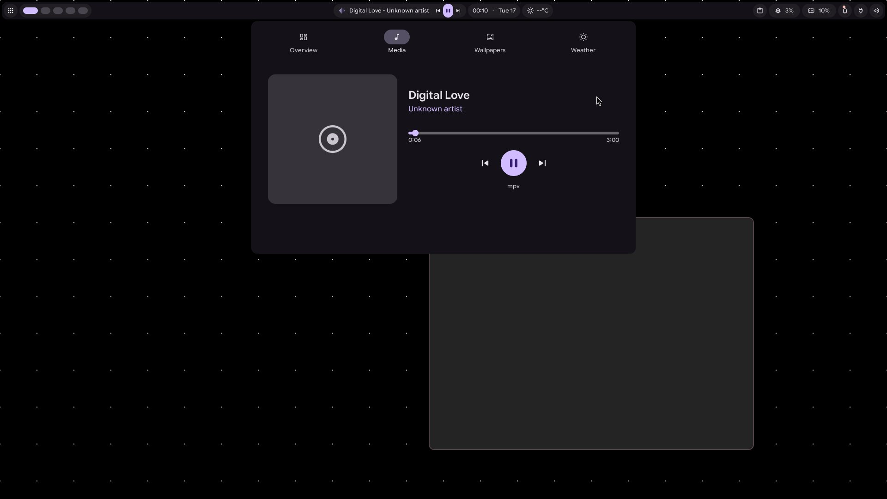 |
| **Tela de bloqueio (hyprlock)** | **Central com tema dinâmico** |
| 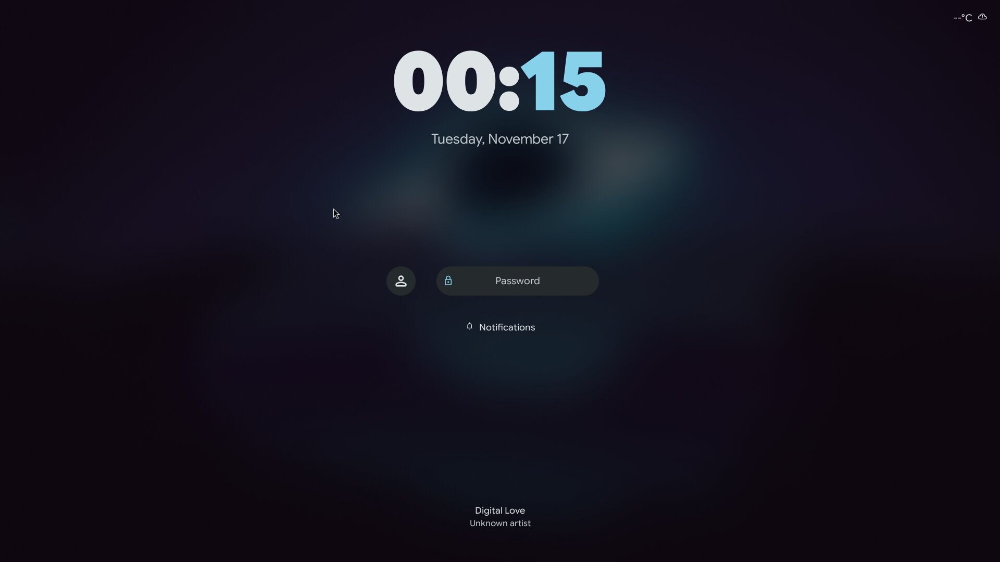 | 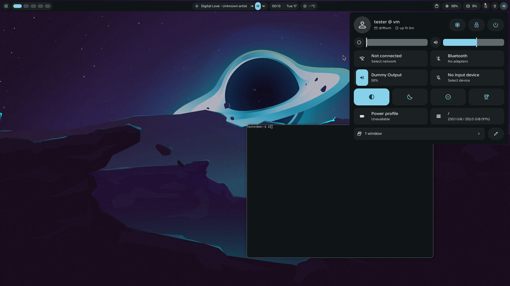 |

### Lado a lado com o original

Prints do DMS v2.1.2 (esquerda) e do DarkMaterial (direita), mesma resolução, mesmo tema (o roxo padrão do DMS) e mesmo wallpaper. O DMS foi rodado no sway headless (no driftwm ele roda igual) e o DarkMaterial no driftwm aninhado.

| | |
|---|---|
| Barra + Central | 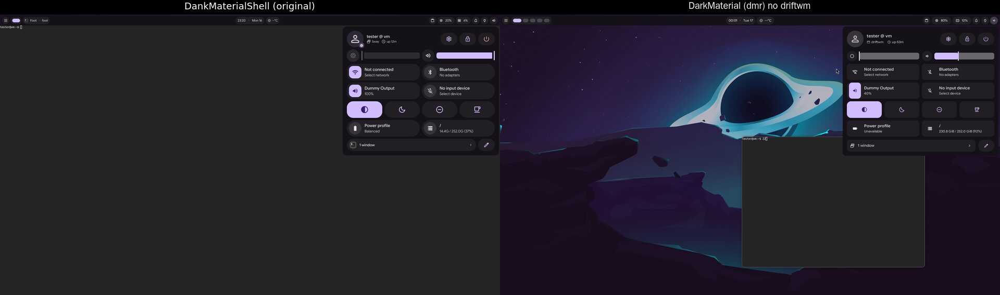 |
| Spotlight | 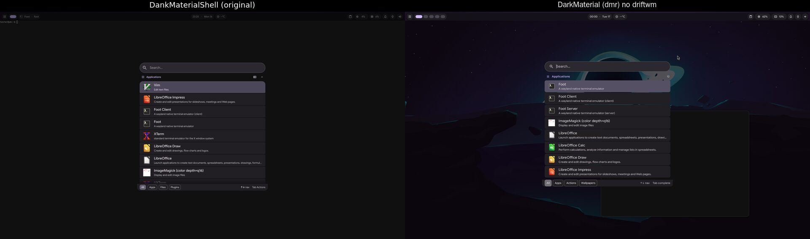 |
| DankDash | 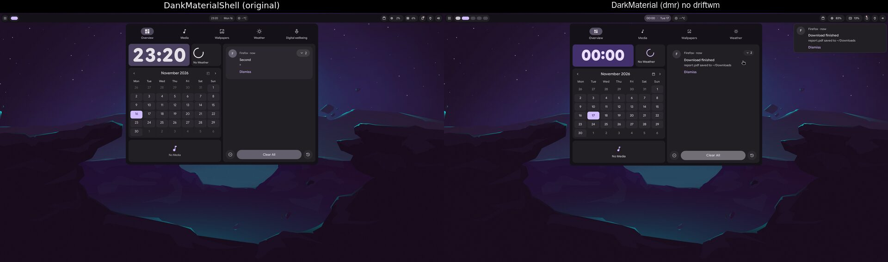 |
| Notificações | 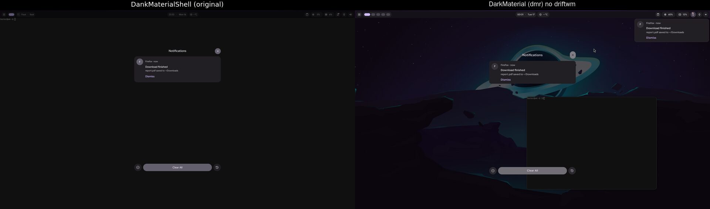 |
| Energia | 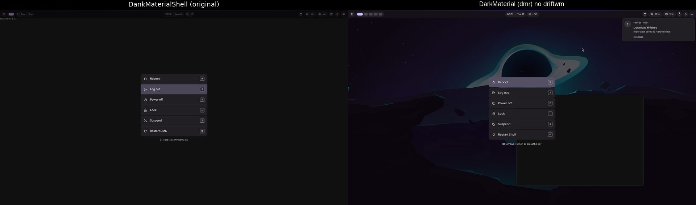 |
| OSD | 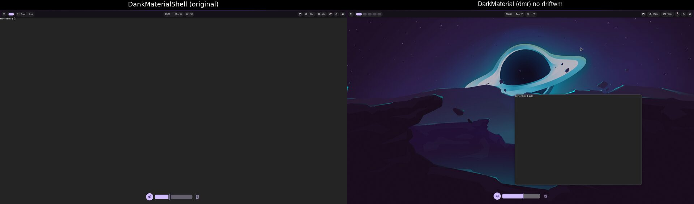 |
| Bloqueio | 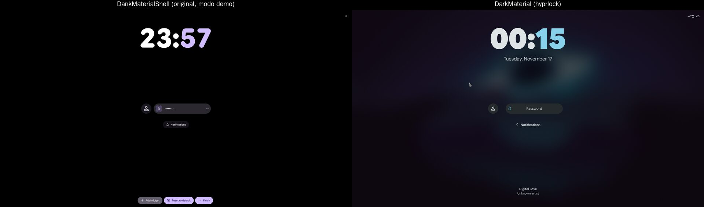 |

As medidas da interface (barra flutuante de 38 px a 4 px das bordas, pílulas de 30 px, cantos de 12 px, painéis em `surface`, cards em `surfaceContainer`, linhas de 56 px no Spotlight, central de 598 px, dash de 832 px) foram tiradas pixel a pixel desses prints.

---

## Desempenho

Medido no mesmo ambiente para os dois: sway headless → driftwm aninhado → shell, 1920×1080, renderização por software (llvmpipe), 4 vCPUs. CPU em % de um núcleo (média de 30–60 s); memória em PSS somando todos os processos do shell.

| Situação | DMS original (quickshell + dms) | DarkMaterial (dmr + EWW + listeners) |
|---|---|---|
| Ocioso (só a barra) | 0,17 % · **310 MiB** | **0,03 %** · **61 MiB** |
| Central de Controle aberta | 0,20 % · 330 MiB | ≤ 0,03 % · 65 MiB |
| DankDash aberta | 0,17 % · 359 MiB | 0,10 % · 67 MiB |
| Spotlight aberto | — | 0,20 % · 75 MiB |

(Resolução da medida: 1 tick de CPU em 30 s = 0,03 %. O PSS do DarkMaterial é ~51 MiB do EWW com os três painéis persistentes já construídos, ~4 MiB do daemon e ~0,5 MiB por listener.)

Por que gasta pouco:

- **Tudo é orientado a eventos, sem polling.** driftwm pelo IPC `subscribe`; áudio por um único `pactl subscribe`; rede e Bluetooth por sinais D-Bus do NetworkManager e do BlueZ; mídia por MPRIS; brilho por `poll(POLLPRI)` no sysfs; notificações pelo próprio servidor `org.freedesktop.Notifications` do daemon.
- **Daemon single-thread.** Um runtime tokio `current_thread` com zbus; ~4 MiB de PSS.
- **Relógio uma vez por minuto.** O daemon publica a hora exatamente na virada do minuto (o `EWW_TIME` acordaria todo widget de relógio a cada segundo). A posição da música só "tica" com a aba Mídia visível e algo tocando.
- **CPU/RAM da barra:** só dois `read()` em `/proc` a cada 3 s (`bar.sysInterval`); o monitor completo (disco etc.) só roda com a Central aberta.
- **Painéis pesados persistentes.** Central de Controle, DankDash e central de notificações são criados uma vez e depois só revelados. Spotlight e menu de energia (que precisam do teclado) são mapeados ao abrir e destruídos ao fechar, para nunca segurarem o foco.
- **Barra gerada sob medida.** O daemon escreve no `_gen.yuck` só os widgets listados em `bar.left/center/right`; nada de ramos escondidos ocupando memória.
- **EWW com o patch do Sheels** (`nix/eww-dmr.patch`): memoiza o valor de cada propriedade e cada lista de `for` (o EWW original chama todos os setters GTK a cada atualização, mesmo com valor igual) — ~8× menos CPU por atualização; corrige `:visible`; adiciona `:onkeypress`/`:autofocus` no `input`; trunca texto colado em uma linha.
- **Listeners minúsculos:** cada tópico é um `dmr listen <tópico>` só com std (~0,5 MiB); só os tópicos usados por janelas abertas ficam ativos.
- **Sem processos órfãos:** os comandos ao EWW usam `--no-daemonize` (nunca sobem um EWW paralelo), cada `dmr listen` sai sozinho quando o EWW some, e se o EWW cair o daemon o reinicia e reconstrói a barra e os painéis.
- **fontconfig próprio para o EWW**, isolado do GTK CSS do usuário, sem ponte de acessibilidade e sem GL.

---

## Arquitetura

```
driftwm ──IPC JSON (subscribe)───┐
PipeWire (pactl subscribe) ──────┤
NetworkManager / BlueZ (D-Bus) ──┤                 deflisten          ┌──────────┐
MPRIS (D-Bus) ───────────────────┼──► dmr daemon ───────────────────► │   EWW    │ ──► layer-shell
org.freedesktop.Notifications ◄──┤    (Rust)     ◄─────────────────── │ (patch)  │
/sys (bateria, backlight) ───────┤                  dmr <comando>     └──────────┘
Open-Meteo (clima) ──────────────┘      │ tema Material You do wallpaper
                                        ├─► _theme.scss (EWW recompila ao vivo)
                                        ├─► cores + wallpaper no config do driftwm
                                        └─► templates: hyprlock, foot, gtk, btop, fuzzel, qt…
```

- `daemon/` — backend em Rust. Publica tópicos JSON (`wm status media notifs load sys launcher ui theme info clock mpos walls`).
- `eww/` — visual: `yuck/*.yuck` e `eww.scss`.
- `templates/`, `schemes/` — templates de app e esquemas de cor (incluindo `dms/purple`, o tema padrão do DMS).
- `config/driftwm/config.toml` — config do driftwm com os **atalhos padrão do DMS**.
- `nix/` — pacote, módulos NixOS (com e sem flake) e o patch do EWW.

### Lições aplicadas (do Sheels)

- `:visible` não funciona em widget customizado → sempre envolvido numa `box`.
- `min-height`/`margin` não funcionam em `eventbox` → aplicados na caixa de dentro.
- Texto do usuário nunca entra em comando de shell: o Spotlight e a senha do Wi-Fi vão por heredoc (`<<'__DMR_EOF__'`), e redes, dispositivos, wallpapers e notificações são sempre referenciados por índice/id.
- O layout de teclado não é forçado para `us`: o `dmr setup` grava o layout do sistema (`localectl`) ou não grava nenhum.
- Novo neste projeto: o EWW coloca o nome da janela como classe CSS no `GtkWindow`, então nenhuma classe interna pode ter o mesmo nome de uma janela (`.bar`, `.osd`, `.dash`…).

---

## Instalação (NixOS)

### Um comando

```bash
curl -fsSL https://raw.githubusercontent.com/pabl0conepc-alt/DarkMaterial-on-Rust/main/install.sh | bash
```

Ele cria `/etc/nixos/darkmaterial.nix` (importado no `configuration.nix`, com backup), adiciona o driftwm se ainda não existir, recompila o sistema usando no máximo 2 núcleos (o EWW é compilado com o patch) e roda `dmr setup` para o seu usuário. Rodar de novo atualiza. Depois é só sair e escolher **driftwm** no login.

### Sem flake (manual)

```nix
# configuration.nix
{
  imports = [
    "${builtins.fetchTarball "https://github.com/pabl0conepc-alt/DarkMaterial-on-Rust/archive/main.tar.gz"}/nix/module.nix"
  ];
  programs.darkmaterial.enable = true;
  # o driftwm vem do módulo dele (programs.driftwm.enable), como no README do driftwm
}
```

### Com flake

```nix
{
  inputs = {
    nixpkgs.url = "github:NixOS/nixpkgs/nixos-unstable";
    darkmaterial.url = "github:pabl0conepc-alt/DarkMaterial-on-Rust";
    darkmaterial.inputs.nixpkgs.follows = "nixpkgs";
  };

  outputs = { nixpkgs, darkmaterial, ... }: {
    nixosConfigurations.meupc = nixpkgs.lib.nixosSystem {
      system = "x86_64-linux";
      modules = [
        ./configuration.nix
        darkmaterial.nixosModules.default   # driftwm + shell
        { programs.darkmaterial.enable = true; }
      ];
    };
  };
}
```

Use `darkmaterial.nixosModules.darkmaterial` se você já importa o módulo do driftwm por conta própria.

O módulo ativa: fontes (Material Symbols Rounded e Google Sans Flex), NetworkManager, Bluetooth, PipeWire (+pulse), power-profiles-daemon, UPower, PAM do hyprlock e o portal XDG.

### Depois de instalar: `dmr setup`

```bash
dmr setup
```

Instala `~/.config/driftwm/config.toml` com os atalhos do DMS e o `dmr daemon` no autostart (o anterior vira `.bak`), mantém o seu layout de teclado, cria `~/Pictures/Wallpapers` e faz um check-up (fontes, `pactl`, `nmcli`, `hyprlock`, `wlsunset`…). `dmr setup --check` só verifica.

---

## Atalhos (os padrões do DMS)

| Atalho | Ação |
|---|---|
| `Super+Space` | Spotlight (launcher) |
| `Super+A` | Central de Controle |
| `Super+D` / `Super+M` / `Super+Y` | DankDash: Overview / Mídia / Wallpapers |
| `Super+Ctrl+N` | Central de notificações |
| `Super+X`, `Ctrl+Alt+Delete` | Menu de energia (↑/↓, Enter, Esc ou as teclas R X P L S D) |
| `Super+V` | Histórico da área de transferência |
| `Super+Alt+L` | Bloquear |
| `Super+Alt+N` / `Super+Alt+I` | Modo noturno / manter acordado |
| `Super+,` | Configurações (`settings.json` no editor) |
| `Super+T`, `Super+Return` | Terminal |
| `Super+1…5` / `Super+Alt+1…5` / `Super+Shift+1…5` | Ir para o workspace (bookmark) / mover janela / salvar posição |
| `Print` / `Ctrl+Print` | Captura de região / tela inteira |
| Teclas de mídia, volume e brilho | Com OSD |
| `Super+H`, `Super+O` | Origem do canvas / visão geral (driftwm; `Super+A` ficou com a Central como no DMS) |

No Spotlight: `>` lista ações (`>wallpaper`, `>scheme`, `>variant`, `>light`, `>dark`, `>lock`, calculadora com `>calc 2+2`), `Tab` completa, `↑/↓` navega, `Enter` abre e `Esc` fecha.

## Configuração

Tudo em `~/.config/dmr/settings.json`, só com as chaves que você quer mudar; `dmr config set <chave> <valor>` muda ao vivo:

```json
{
  "bar": {
    "left":   ["launcherButton", "workspaceSwitcher", "focusedWindow"],
    "center": ["music", "clock", "weather"],
    "right":  ["systemTray", "clipboard", "cpuUsage", "memUsage", "notificationButton", "battery", "controlCenterButton"],
    "floating": true,
    "sysInterval": 3000
  },
  "services": { "weatherLocation": "São Paulo", "clockFormat": "24h", "smartScheme": true },
  "notifs": { "defaultExpireTimeout": 5000 },
  "osd": { "hideDelay": 2000 },
  "paths": { "wallpaperDir": "~/Pictures/Wallpapers", "face": "~/.face" }
}
```

Widgets da barra disponíveis: `launcherButton`, `workspaceSwitcher`, `focusedWindow`, `music`, `clock`, `weather`, `systemTray`, `clipboard`, `cpuUsage`, `memUsage`, `notificationButton`, `battery`, `controlCenterButton`, `idleInhibitor`, `powerMenuButton`.

Tema: `dmr scheme set dynamic` (Material You do wallpaper, padrão), `dmr scheme set dms purple` (o roxo padrão do DMS), ou qualquer esquema em `schemes/` (catppuccin, gruvbox, nord, rosepine…). `dmr wallpaper set <arquivo>` troca o wallpaper (o driftwm desenha o fundo) e regenera as cores.

---

## Diferenças em relação ao DMS

- **Workspaces são bookmarks do driftwm** (canvas infinito). A pílula fica "ocupada" quando há janela perto daquele ponto.
- **Settings**: o DMS tem uma janela de configurações gigante; aqui o botão abre o `settings.json` no editor e `dmr config set` muda tudo ao vivo.
- **Bloqueio** pelo hyprlock com template no estilo do lock do DMS (relógio grande com os minutos na cor primária, avatar + campo de senha em pílula). Autenticação por PAM e digital via fprintd.
- **Não implementados**: dock, notepad, gerenciador de processos, plugins, letras sincronizadas, visualizador de áudio, aba "Digital wellbeing", desktop widgets. O Spotlight não busca arquivos (só apps, ações, calculadora, esquemas e wallpapers).
- **Animações**: os painéis deslizam/esmaecem com as curvas do Material 3, sem o "spring" e o blur do Quickshell.
- O fundo escurecido dos modais não cobre a barra (o EWW não permite zona exclusiva −1).

## Desenvolvimento

```bash
cd daemon && cargo build --release
DMR_SHARE=$PWD/.. DMR_EWW_LOG=1 ./target/release/dmr daemon   # dentro de uma sessão Wayland (driftwm, ou sway sem workspaces)
```

O EWW precisa estar com o patch: `nix-build -E 'with import <nixpkgs> {}; callPackage ./nix/package.nix {}'`.

---

## Créditos

Este é um trabalho derivado e não existiria sem:

- **[DankMaterialShell](https://github.com/AvengeMedia/DankMaterialShell)** (hoje *Dux Modular Shell*), da **[Avenge Media](https://github.com/AvengeMedia)** — de **[bbedward](https://github.com/bbedward)**, **[purian23](https://github.com/purian23)** e todos os [contribuidores](https://github.com/AvengeMedia/DankMaterialShell/graphs/contributors). Daqui vieram o design inteiro, o layout e o comportamento de cada módulo, o tema roxo padrão e os atalhos. Licença MIT.
- **[driftwm](https://github.com/malbiruk/driftwm)**, de **Klim Kostiuk ([malbiruk](https://github.com/malbiruk))**, o compositor de canvas infinito (GPL-3.0).
- **[Sheels](https://github.com/pabl0conepc-alt/Sheels)**, de onde vêm a arquitetura, o daemon base, o patch do EWW e o gerador Material You (portado do caelestia-cli) — e por tabela **[Caelestia](https://github.com/caelestia-dots/shell)** / **[caelestia-cli](https://github.com/caelestia-dots/cli)** (soramanew e contribuidores), pelos esquemas de cor e templates.
- **[EWW](https://github.com/elkowar/eww)**, de **[elkowar](https://github.com/elkowar)** e contribuidores.
- **[Quickshell](https://quickshell.org)** ([outfoxxed](https://github.com/outfoxxed)), base do DMS original.
- **[material-colors](https://github.com/Aiving/material-colors)** (Aiving), port do material-color-utilities do Google.
- **Fontes:** [Material Symbols](https://github.com/google/material-design-icons) e [Google Sans Flex](https://fonts.google.com) (Google; Apache-2.0 / OFL).
- **[hyprlock](https://github.com/hyprwm/hyprlock)** (hyprwm), **[wlsunset](https://sr.ht/~kennylevinsen/wlsunset/)**, **[cliphist](https://github.com/sentriz/cliphist)**, **[fuzzel](https://codeberg.org/dnkl/fuzzel)**.
- **[Open-Meteo](https://open-meteo.com)** pelo clima.

## Licença

**GPL-3.0** (o código derivado do Sheels/caelestia-cli é GPL-3.0; o DMS é MIT e o driftwm é GPL-3.0). Veja `LICENSE`. A fonte Google Sans Flex em `fonts/` é distribuída sob a SIL OFL 1.1 (`fonts/LICENSE`).
